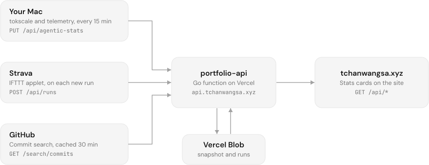

<div align="center">

<picture>
  <source media="(prefers-color-scheme: dark)" srcset=".github/assets/banner-dark.svg">
  
</picture>

<p>
  <a href="#routes"><strong>Routes</strong></a>
  &nbsp;·&nbsp;
  <a href="#telemetry"><strong>Telemetry</strong></a>
  &nbsp;·&nbsp;
  <a href="https://github.com/Tchanwangsa/portfolio-v3"><strong>The site</strong></a>
</p>

<p>
  <a href="https://go.dev/"></a>&nbsp;
  <a href="https://vercel.com/"></a>&nbsp;
  
</p>

</div>

## About

The backend for the live stats cards on [tchanwangsa.xyz](https://tchanwangsa.xyz). A Go function on Vercel collects three feeds, keeps them in a private Vercel Blob store and serves them as public JSON at `api.tchanwangsa.xyz`. The repo also holds `telemetry`, the macOS collector that reports my coding-agent usage.

<picture>
  <source media="(prefers-color-scheme: dark)" srcset=".github/assets/overview-dark.svg">
  
</picture>

## Feeds

- **Agentic coding**: `telemetry` reads local usage with [tokscale](https://github.com/junhoyeo/tokscale) and publishes a seven-day snapshot every 15 minutes. Only daily token totals, the session count and the most used model leave the machine.
- **Strava runs**: an IFTTT applet posts each new activity. The API works out the time zone a run happened in from its route map, and keeps eight weeks of runs.
- **GitHub commits**: pulled from GitHub's commit search and cached for 30 minutes. Private repositories contribute only commit times, rounded down to 15 minutes.

Commit and run times are served as timestamps, and the site groups them into each visitor's local days and weeks.

## Routes

| Route | Purpose |
| --- | --- |
| `GET /api/agentic-stats` | Latest token usage snapshot |
| `PUT /api/agentic-stats` | Publish a snapshot. Needs `Authorization: Bearer <STATS_PUBLISH_TOKEN>` |
| `GET /api/github-stats` | Commit times from the last seven days and the latest public commit |
| `GET /api/runs` | Runs from the last eight weeks and the latest run |
| `POST /api/runs` | Record a run. Needs `Authorization: Bearer <RUNS_WEBHOOK_TOKEN>` |
| `GET /healthz` | Returns `204` while the API is up |

### Strava webhook

The IFTTT applet sends this body to `POST /api/runs`:

```json
{
  "name": "{{Name}}",
  "activityType": "{{ActivityType}}",
  "createdAt": "{{CreatedAt}}",
  "distanceMeters": "{{DistanceMeters}}",
  "elapsedTimeInSeconds": "{{ElapsedTimeInSeconds}}",
  "linkToActivity": "{{LinkToActivity}}",
  "routeMapImageUrl": "{{RouteMapImageUrl}}"
}
```

`createdAt` is wall-clock time where the run happened, and the start of the route map gives its time zone. Runs without a map, such as treadmill runs, use the latest mapped run's time zone, or Melbourne if there is none. The API ignores activities that aren't runs, and repeat deliveries.

## Telemetry

Set it up on a Mac:

```sh
npm install -g tokscale
cp telemetry/.env.example telemetry/.env    # then set STATS_PUBLISH_TOKEN
go run ./telemetry install -env-file telemetry/.env
```

`install` publishes once, copies the collector and its settings to `~/.local/share/portfolio-telemetry`, and schedules it with launchd to run every 15 minutes and at login.

| Command | Effect |
| --- | --- |
| `go run ./telemetry status` | Show the schedule, settings, latest snapshot and last error |
| `go run ./telemetry run` | Collect and publish once |
| `go run ./telemetry uninstall` | Stop the collector and keep its settings, so `install` resumes without flags |
| `go run ./telemetry uninstall -purge` | Stop the collector and delete its settings and data |

The site hides the agentic coding card once the latest snapshot is three days old.

## Run it

You'll need [Go](https://go.dev) 1.25 or newer.

```sh
cp server/.env.dev.example server/.env.dev          # then set STATS_PUBLISH_TOKEN
go run ./server -env-file server/.env.dev           # API on http://127.0.0.1:8787
go run ./telemetry run -env-file server/.env.dev    # publish a snapshot to it
go test ./...
```

Locally the API stores data in files under `data/` instead of Blob.

| Path | Contents |
| --- | --- |
| `portfolioapi/` | Route handlers and storage |
| `api/`, `server/` | Entry points for Vercel and for local use |
| `telemetry/` | The coding-agent usage collector |
| `internal/` | Snapshot format and settings loader, shared by the API and the collector |

### Settings

| Variable | Purpose |
| --- | --- |
| `STATS_PUBLISH_TOKEN` | Required. At least 32 random characters |
| `STATS_ALLOWED_ORIGINS` | Comma-separated origins allowed to read the API from a browser |
| `GITHUB_USERNAME`, `GITHUB_TOKEN` | Turn on the GitHub route. Use a fine-grained token with **Public repositories** selected and no added permissions |
| `GITHUB_PRIVATE_TOKEN` | Optional. A fine-grained token for the private repositories to count |
| `RUNS_WEBHOOK_TOKEN` | Turns on the runs routes. At least 32 random characters, different from the publish token |
| `BLOB_STORE_ID`, `BLOB_READ_WRITE_TOKEN` | Required on Vercel. The private Blob store that holds the data |
| `STATS_DATA_FILE` | Local storage path. Defaults to `data/agentic-stats.json`, with runs saved beside it |
| `STATS_LISTEN_ADDR` | Local server address. Defaults to `127.0.0.1:8787` |

## Deploy

Pushing to `main` deploys to Vercel, which serves `api.tchanwangsa.xyz`. `api/portfolio.go` is the function, and `vercel.json` routes the paths above to it. The project needs a private Blob store connected to Production and the settings above.
